<div align="center">


<br>

[](https://wad2project-three.vercel.app)
[](https://youtu.be/dyAAQinzaXk)
[](https://docs.google.com/presentation/d/1pyFkyaEaEO6-injb82y0LX8NB72YEIo95fyOe0_I_Pw/edit?usp=sharing)

**[Getting started](#getting-started)** · **[Test accounts](#test-accounts)** · **[Video](#video)** · **[Screens](#screens)** · **[Features](#features)** · **[Tests](#testing)** · **[Team](#team)**


</div>

## Getting started

Riffle is a Vue 3 + Vite app. It talks to our hosted Supabase project, so **there is nothing to set up besides cloning it**: no database, no account, no API keys.

<div align="center">


</div>

### What you need

| | |
|---|---|
| **Node.js** | `22.18` or newer, or `24.12` or newer. Check with `node -v`. |
| **pnpm** | `npm install -g pnpm`. Check with `pnpm -v`. |
| **A browser** | Any recent Chrome, Edge, Firefox or Safari. |

### 1. Clone and install

```sh
git clone https://github.com/kens8152/wad2project.git
cd wad2project
pnpm install
```

### 2. Add the environment file

```sh
cp .env-example .env          # Windows Command Prompt: copy .env-example .env
```

That is the whole setup. `.env-example` already holds the Riffle Supabase project's URL and its **publishable** key, so the app connects to our database with all its artists, events and forum posts.

> The publishable key is meant to be public: it can only do what the database's Row Level Security rules allow. The secret key is never in this repository.

### 3. Start the app

```sh
pnpm dev
```

Open **<http://127.0.0.1:5173>**. Use `127.0.0.1` rather than `localhost`: Spotify sign-in is registered for that address.

| Command | What it does |
|---|---|
| `pnpm dev` | Start the dev server at `http://127.0.0.1:5173` |
| `pnpm build` | Build for production into `dist/` |
| `pnpm preview` | Serve the production build locally |
| `pnpm test:unit` | Run every Vitest test once |
| `pnpm test:e2e` | Run the Playwright end-to-end tests |

### Check that it works

1. The landing page `/welcome` shows a spinning record, and **Discover** shows a web of about 180 coloured dots.
2. **Events** shows a map with coloured pins and a row of event cards. Allow location when asked and the map centres on you.
3. **Artists** lists artists, and clicking one opens its profile.
4. Resize the window to phone width: the navbar collapses into a menu and every page re-flows.

### If something goes wrong

| Problem | Fix |
|---|---|
| `Command "dev" not found` | You are in the wrong folder. Run it from the project root, the folder that contains `package.json`. |
| Blank page or "Supabase" errors in the console | The `.env` file is missing or misnamed. It must be called exactly `.env`, in the project root, copied from `.env-example`. Restart `pnpm dev` after creating it. |
| `Port 5173 is in use` | Another copy is running. Stop it with `Ctrl + C`, or on macOS run `lsof -ti :5173 \| xargs kill`. |
| `Cannot find native binding` or `library load disallowed by system policy` when running `pnpm dev` | The `node_modules` folder was copied or unzipped from somewhere else, which breaks the compiled files inside it. Never copy `node_modules`. In the project folder run `rm -rf node_modules && pnpm install`, then `pnpm dev`. On a Mac, if the folder came from a browser download, also run `xattr -dr com.apple.quarantine .` first. |
| Node version error | Install Node 22.18+ or 24.12+ (for example with [nvm](https://github.com/nvm-sh/nvm)). |
| Map tiles are grey | The map needs internet access to load OneMap tiles. |
| The page was dark and you want light | Light mode is the default. If you switched once, your browser remembers it: use the sun and moon button in the navbar. |


## Test accounts

You can try everything on the **live app** without installing anything: **<https://wad2project-three.vercel.app>** (works on phones too).

### Spotify test account

Onboarding has an optional **Connect Spotify** step that suggests genres from your listening. Use this shared tester account when you try it:

| | |
|---|---|
| **Email** | `riffletester@gmail.com` |
| **Password** | `riffletester123` |

> A throwaway account made only for testing Riffle. It holds no personal data.

### A two-minute tour

1. Open the app and press **Guide** on *Discover*: the page walks you through the web of artists.
2. Click any dot to see the artists who share its fans, and open its card.
3. **Events**: the live map, your location, search and filters. Open an event for its mini map.
4. **Match me with artists** (the purple cards button in the navbar): swipe, hear a 30 second preview, save artists.
5. **Sign up**: you land in onboarding, pick genres (or connect the Spotify test account above), then arrive on Discover.


## Video

<div align="center">

[](https://youtu.be/dyAAQinzaXk)

**[Watch the marketing video on YouTube](https://youtu.be/dyAAQinzaXk)**  ·  **[Open the presentation slides](https://docs.google.com/presentation/d/1pyFkyaEaEO6-injb82y0LX8NB72YEIo95fyOe0_I_Pw/edit?usp=sharing)**

</div>

## Screens

<div align="center">

| | |
|:---:|:---:|
| **Landing** | **Discover: the web of artists** |
| 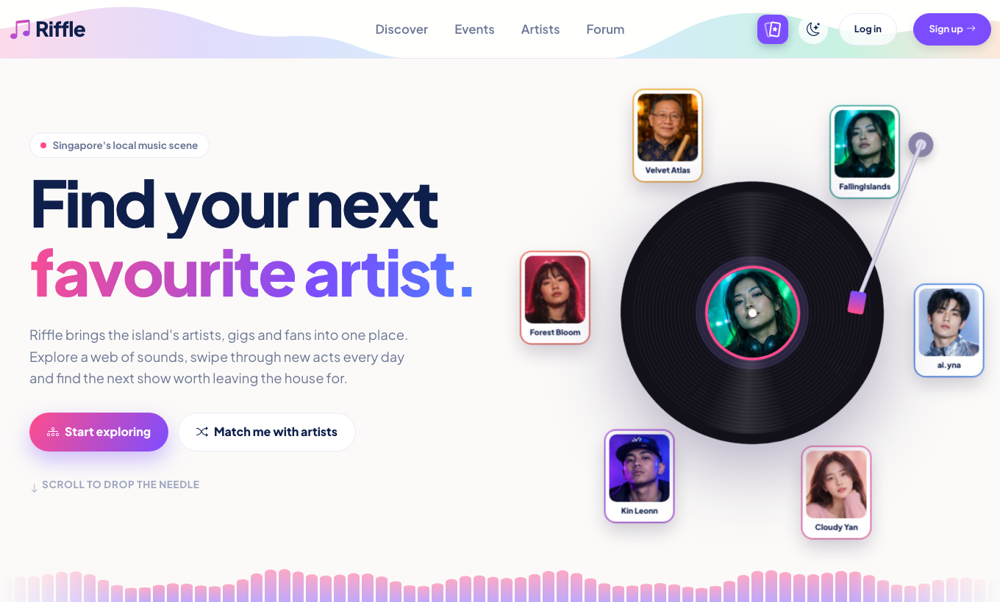 | 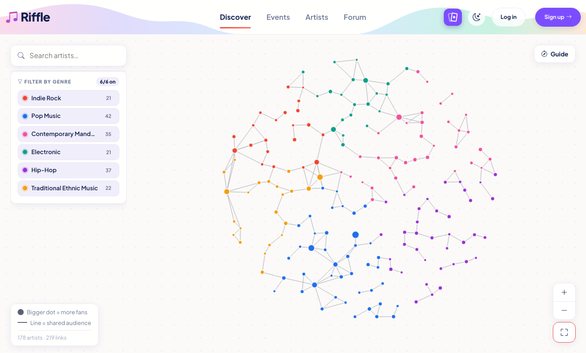 |
| **Discover: open an artist** | **Events: every gig on a live map** |
| 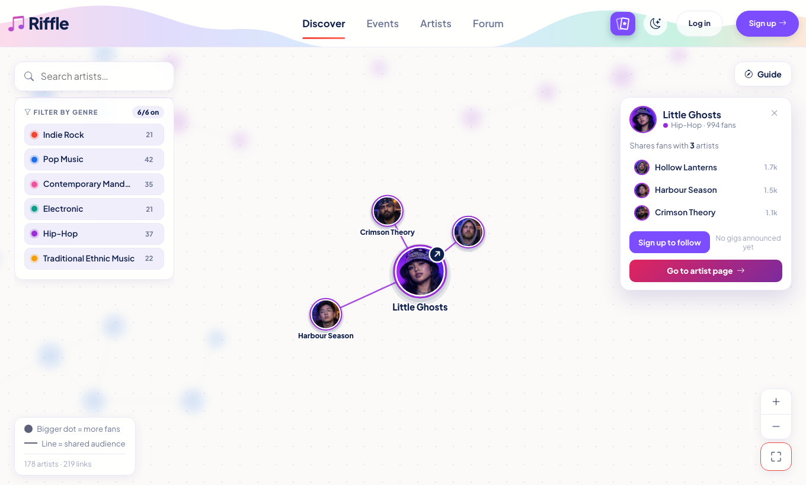 | 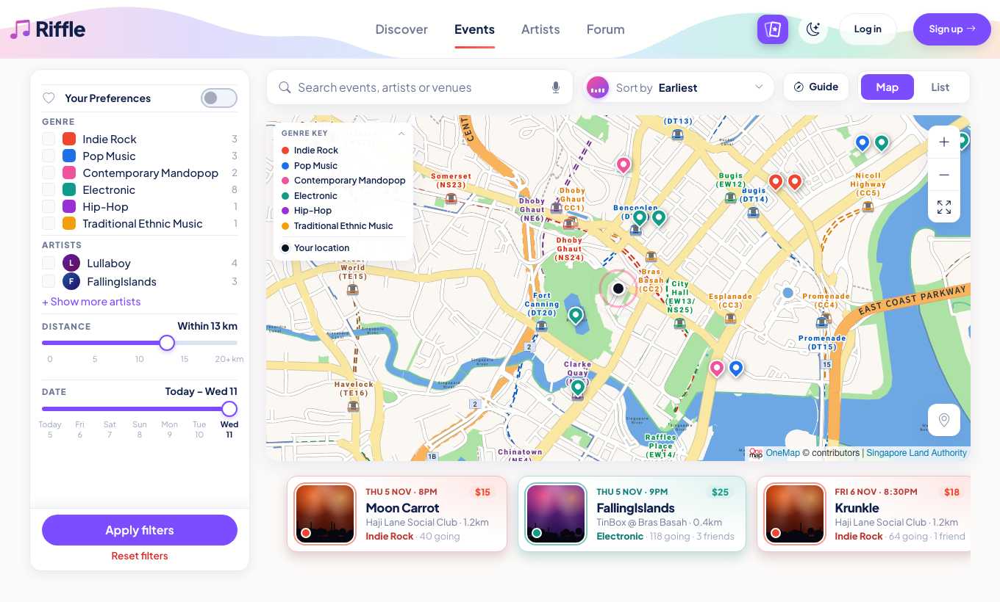 |
| **Events: list view** | **Artists** |
| 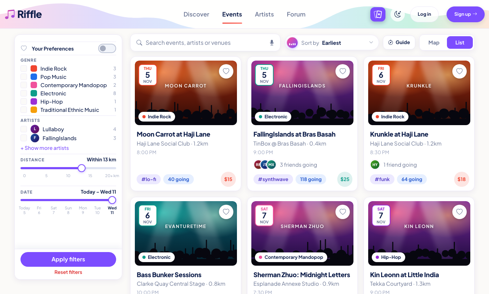 | 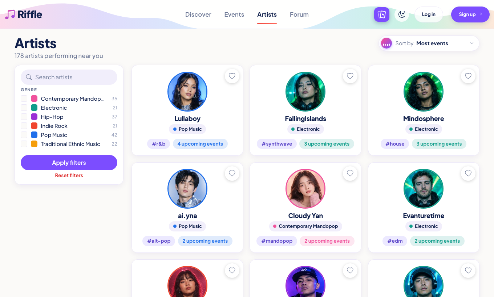 |
| **Artist profile** | **Artist matchmaking** |
| 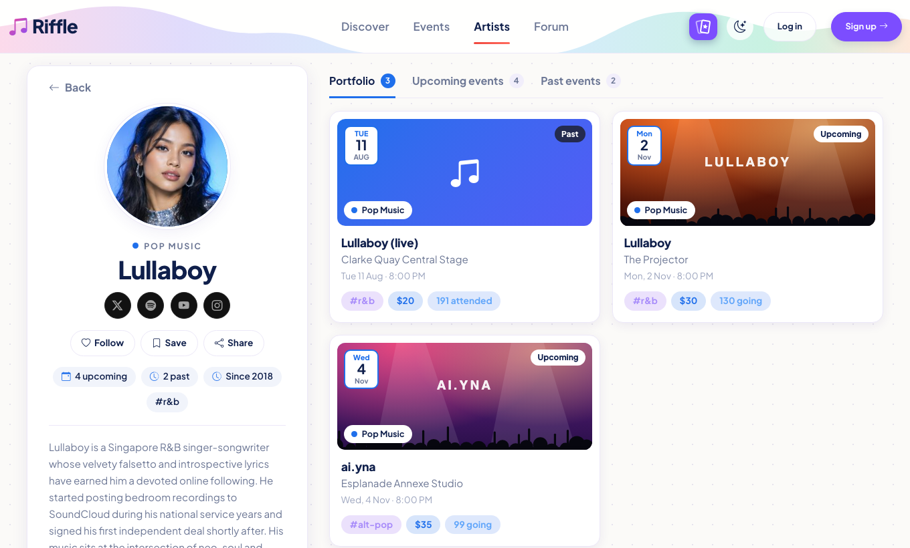 | 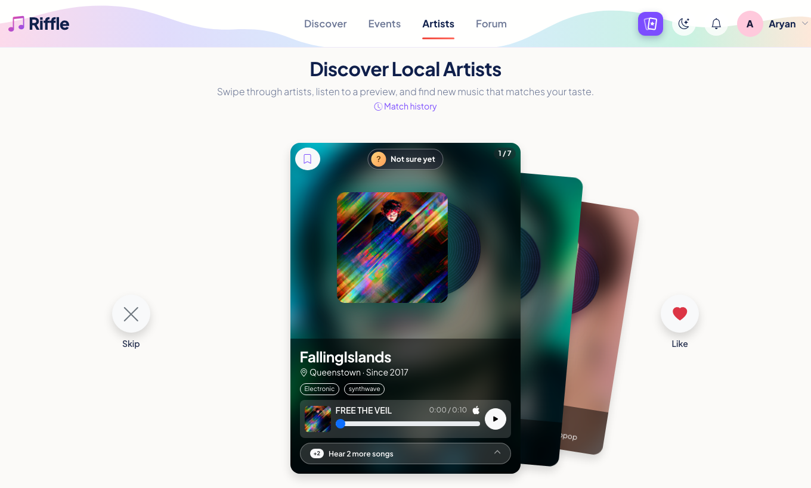 |
| **Profile** | **Notifications** |
| 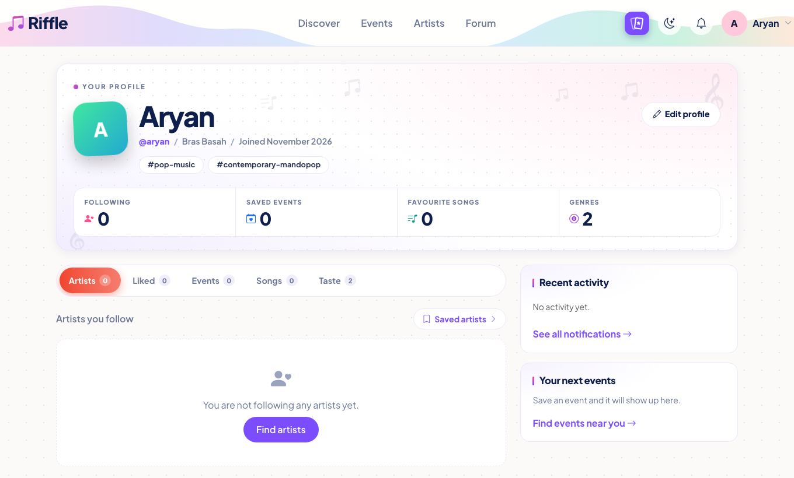 | 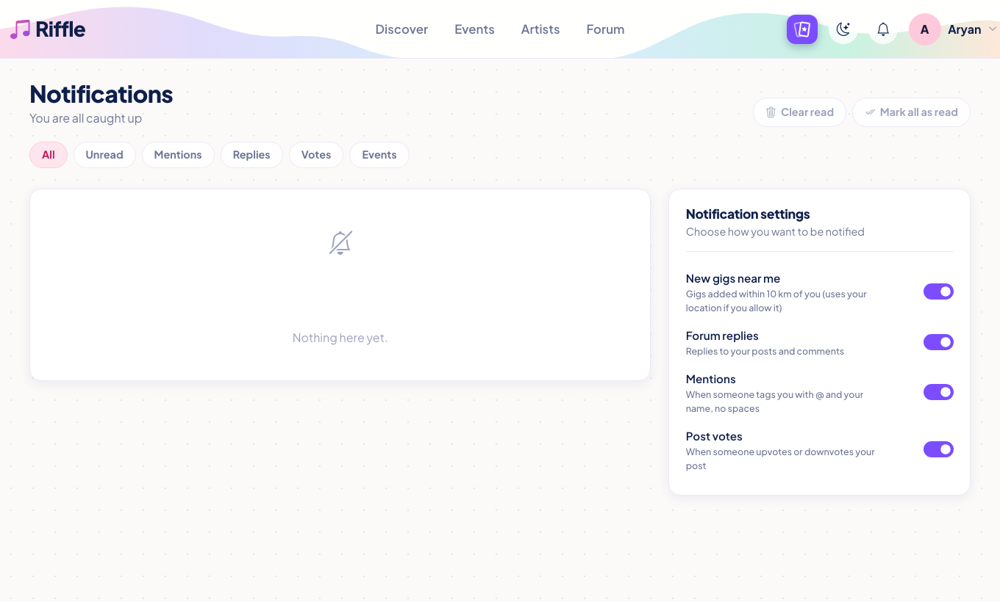 |
| **Forum: trending tags** | **Forum: community posts** |
| 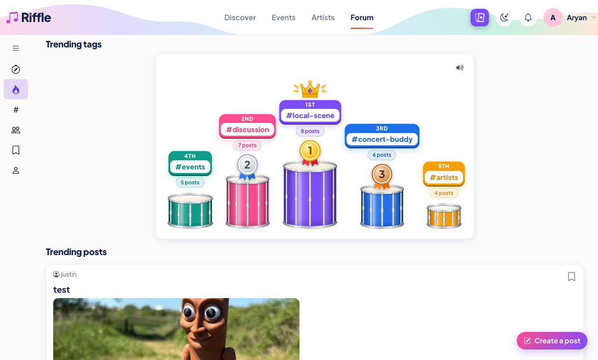 | 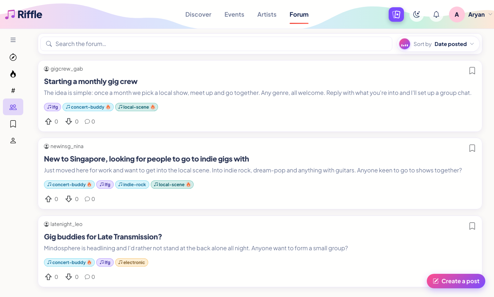 |

**On a phone**

| Landing | Discover | Events | Artist |
|:---:|:---:|:---:|:---:|
| 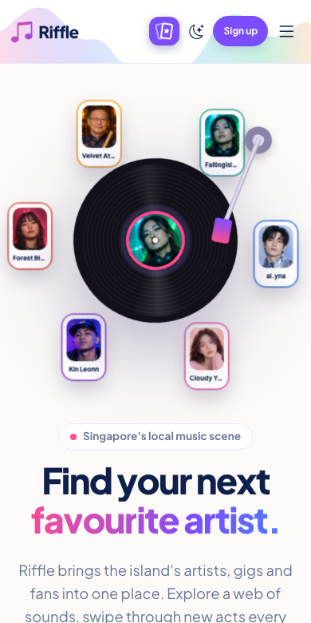 | 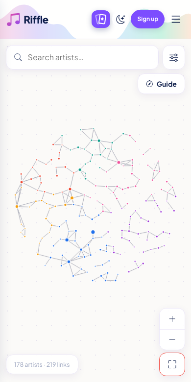 | 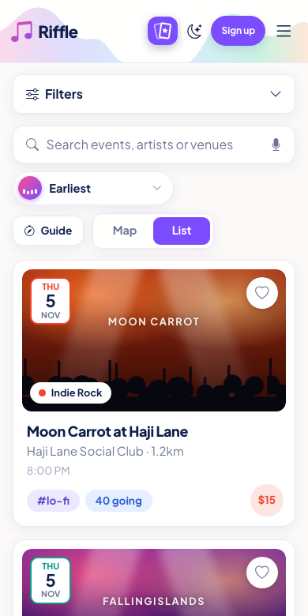 | 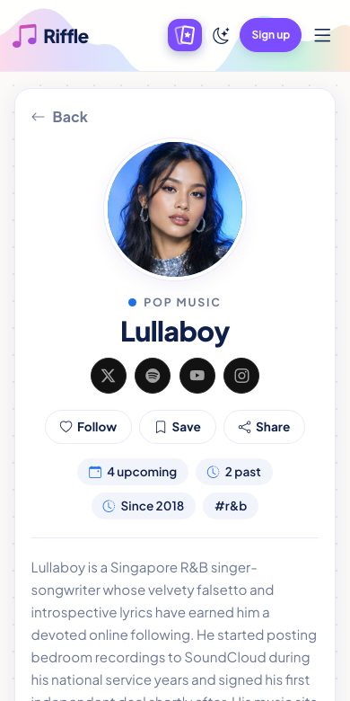 |

| Matchmaking | Profile | Forum |
|:---:|:---:|:---:|
| 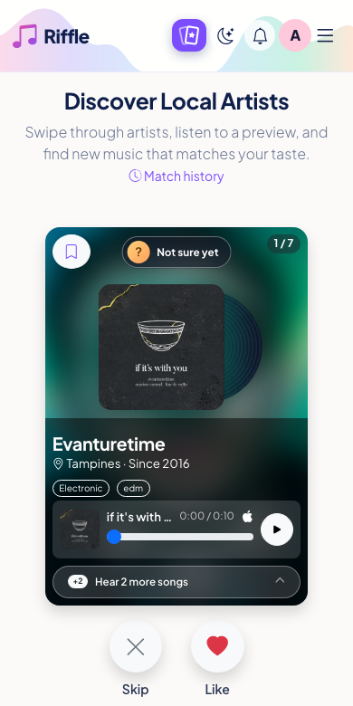 | 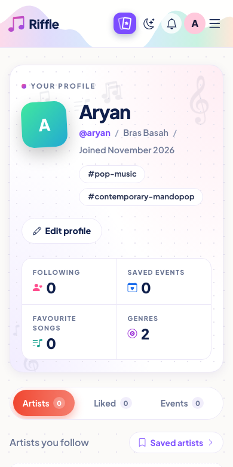 | 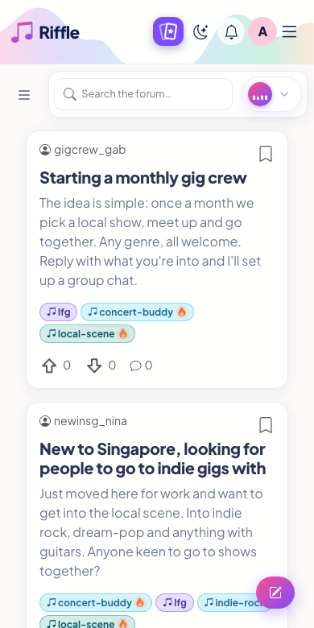 |

</div>


## About Riffle

### The problem

Information about Singapore's local artists, music and events is **scattered across many platforms**. Fans jump between streaming apps, social media, ticketing sites and group chats just to learn who is playing, what they sound like and when their next show is. Local and emerging musicians, in turn, struggle to be seen next to big international acts.

### Our solution

**Riffle** brings local music discovery together in one app. Listeners can explore artists through an interactive web of genres, swipe through personalised artist recommendations with 10-second song previews, browse upcoming gigs on a map, and talk about it all in a community forum. Every artist gets a profile, upcoming events and a place in front of new listeners.

### Our objectives

1. **Simplify music discovery**: one place to find local artists, songs and gigs.
2. **Personalise recommendations**: suggestions shaped by each user's genres, likes and follows.
3. **Centralise and improve music event discovery**: every upcoming gig on one map and list, with filters.
4. **Increase artist visibility**: give local and emerging artists profiles, previews and an audience.
5. **Encourage community engagement**: a forum, messaging and gig-buddy finding for fans.

### Who it is for

| | Local music listeners | Local and emerging artists |
|---|---|---|
| **Who** | Young Singaporeans interested in local music | Musicians who want to showcase their work and reach more listeners |
| **Need** | An easier way to discover artists, songs and upcoming events that match their interests | Greater visibility for their music, profiles and performances |

Riffle works on **smartphones, laptops and desktops**, with a responsive layout that adapts to every screen size, plus a built-in **light and dark mode** (light by default).

## Features

### Discover
- An interactive **web of artists**: drag, zoom and click through dots grouped by genre.
- Click a dot to see the artist's picture grow and the artists who share their fans fly out around it, with a card to follow them or open their page.
- Search, genre and mood filters, and **"Recommended for you"** suggestions for signed-in users.
- A **guided tour** (the Guide button) that walks new users through the page, shown automatically after sign-up.

### Events
- Every upcoming gig on an interactive **map** (Leaflet) or as a **list**, with genre colour-coded pins and cards.
- **Live location**: allow location and the map centres on you, distances update and events sort nearest-first.
- Search (with voice search), filter by genre, artist, date and distance, and sort the results.
- Event pages with the line-up, a mini map that opens the full map zoomed in on the venue, and a discussion thread.
- A **guided tour** for the Events pages too.

### Artists
- Browse all local artists with search, genre and venue filters and sorting.
- Artist profiles with their bio, social links, a portfolio of their best events, plus upcoming and past events, and **Follow** / **Save** buttons.

### Artist matchmaking
- A daily batch of artist cards to **Like** or **Skip**, swipe style.
- Each card plays **10-second song previews** (the chorus of Apple Music's previews, in a custom player).
- **Save** artists to a bookmark list for later.
- **Match history**: review every swipe, change Like ↔ Skip, or undo.
- A fresh batch of unseen artists every day.

### Forum
- Post, comment, upvote and save posts, with tags and **trending** topics.
- **Looking for group (LFG)** posts to find gig buddies.
- Link artists, events and songs into posts.

### Profile and social
- Sign up / log in, with **onboarding** that imports your music taste (optional Spotify connect). New accounts land on Discover when onboarding is done.
- Profile tabs for followed artists, liked artists, saved artists and match history.
- Direct **messages**.
- **Notifications**, saved per person in Supabase and updated live, for:
  - replies to your forum posts and comments,
  - `@mentions` (an @ followed by your display name without spaces),
  - new gigs within 10 km of you.

  Each type can be switched off in the notification settings. You can mark notifications read, remove them one at a time or clear all the read ones.

### Everywhere
- **Responsive**: every screen is checked on phones (down to 320px wide), tablets and desktops.
- **Light and dark mode**, light by default and remembered per device.

## Tech stack

| Area | Tools |
|---|---|
| Front end | [Vue 3](https://vuejs.org/) (`<script setup>`), [Vue Router](https://router.vuejs.org/), [Pinia](https://pinia.vuejs.org/) |
| Styling | [Bootstrap 5.3](https://getbootstrap.com/), [Bootstrap Icons](https://icons.getbootstrap.com/), Plus Jakarta Sans |
| Animation | CSS transitions and keyframes, [GSAP](https://gsap.com/) on the landing page |
| Build tool | [Vite](https://vite.dev/) |
| Database and auth | [Supabase](https://supabase.com/) (Postgres, Auth, Row Level Security) |
| Maps | [Leaflet](https://leafletjs.com/) with OneMap (Singapore Land Authority) tiles |
| Music data | Apple iTunes Search API (song previews), Spotify Web API (onboarding), Last.fm (genres) |
| Hosting | [Vercel](https://vercel.com/) |
| Testing | [Vitest](https://vitest.dev/), [Vue Test Utils](https://test-utils.vuejs.org/), [Playwright](https://playwright.dev/) |

## Project structure

```text
wad2project/
├── docs/                   # README graphics (animated SVGs) and screenshots
├── e2e/                    # Playwright end-to-end tests
├── public/                 # Static files served as-is
├── src/
│   ├── assets/styles/      # Global styles (main.css, forum.css)
│   ├── components/         # Reusable components, grouped by feature
│   │   ├── artists/  discover/  events/  forum/  landing/  layout/  matchmaking/
│   ├── composables/        # Shared logic (useTheme, useSavedArtists, event filters, live location, ...)
│   ├── data/               # Local data files (events, artist profiles, Discover)
│   ├── router/             # Routes and route guards
│   ├── services/           # Supabase, matchmaking, notifications, Spotify, Apple preview and Last.fm calls
│   ├── stores/             # Pinia stores (user, events, messages, notifications)
│   ├── test/               # Shared test setup and fixtures
│   ├── utils/              # Small helper functions
│   ├── views/              # One component per page
│   ├── App.vue
│   └── main.js
├── supabase/
│   ├── schema.sql          # Database tables, access rules, vote and notification triggers, storage bucket (for reference)
│   └── seed.sql            # Starter data: genres, venues, artists, events, forum posts (for reference)
├── .env-example            # Copy to .env: points to the Riffle Supabase project
├── playwright.config.js
├── vercel.json             # Single-page-app routing for Vercel
└── vite.config.js
```

## Testing

Riffle has three layers of automated tests (**489 Vitest tests** plus Playwright end-to-end journeys).

```sh
pnpm install
pnpm exec playwright install chromium     # one time, for the end-to-end tests
pnpm test:unit                            # every Vitest test, once
pnpm test:e2e                             # every Playwright journey (starts the dev server if needed)
```

<details>
<summary><b>The three layers, and how the tests stay stable</b></summary>

<br>

| Layer | Tool | What it checks | Where |
|---|---|---|---|
| Unit | Vitest | Single functions and composables in isolation (dates, distances, artist sorting and filters, artist profiles, following and saving artists, the matchmaking API, the Discover web of artists, dot pictures and guided-tour checks, trending tags, event filters, voting) | `src/**/__tests__/*.spec.js` |
| Component | Vitest + Vue Test Utils | One Vue component on its own: props, user clicks/typing, emitted events, conditional rendering (vote/save buttons, search box, sort menus, artist card, artist filter sidebar, song preview player, the Discover web of dots, login page) | `src/**/__tests__/*.spec.js` |
| Integration | Vitest + Vue Test Utils | Several real pieces working together: Forum home (search + sort + post list), vote buttons + `useVote`, Artists page (sidebar + sort + cards), Matchmaking (swiping, saving, finishing a batch), Match history, Saved artists, Discover (search, genre filters, recommendations, following, the guide), Profile (tabs, unfollowing, liked artists, resetting the taste profile) | `src/**/__tests__/*.integration.spec.js` |
| End-to-end | Playwright | Complete user journeys in a real browser: browsing and searching events, finding and opening artists, matchmaking as a logged-in user (like, skip, save, finish, history), exploring Discover as a guest and as a member, using the Profile page, finding and opening forum posts, navigating the app, dark mode, logging in | `e2e/*.spec.js` |

More commands:

```sh
pnpm vitest              # watch mode: re-runs tests when you save a file (press q to quit)
pnpm vitest run src/views/__tests__/LoginView.spec.js   # run a single file
pnpm exec playwright show-report         # open the HTML report of the last end-to-end run
pnpm exec playwright test --ui           # step through the tests in Playwright's UI
```

- **No real database writes.** Unit and component tests replace Supabase with a mock (`vi.mock`). E2E tests intercept every Supabase request with `page.route()` and answer with fixture data from `e2e/support/mockSupabase.js`, so they give the same result every run, need no account, and never change real data. Events and Artists use the app's built-in data files.
- **Logged-in journeys without a real account.** The matchmaking, Discover and Profile E2E tests use `e2e/support/session.js` to place a fake signed-in session in the browser, and `e2e/support/matchmakingBackend.js` to act as an in-memory database (and Apple Music) that remembers swipes and saves for the length of one test.
- **Stable selectors.** Tests find elements the way a user does: by role and accessible name (`getByRole('button', { name: 'Upvote' })`, `getByLabel('Email address')`, `aria-label`), not by CSS classes or HTML structure.
- **Behaviour, not implementation.** Tests check what the user sees or what a component emits, not internal function calls, so refactoring does not break them.
- **No fixed waits.** Playwright's automatic waiting and Vitest's fake timers (for the debounced event search) replace `sleep` calls.
- **Isolated tests.** Each test mounts a fresh component or loads a fresh page; shared filter state is reset in `beforeEach`.

</details>


## Team

Built for **IS216 Web Application Development II**.

| Member | Main areas |
|---|---|
| Yan Tat | Artist matchmaking, saved artists, match history |
| Kenson | Login, sign up, onboarding, profile |
| Powell Li | Artists pages and artist profiles |
| Aryan Kashikar | Events (map, list, details, live location) and Discover (web of artists, guided tour) |
| Justin Ong | Forum, navbar, dark mode |

## Acknowledgements

- **Maps:** map tiles from [OneMap](https://www.onemap.gov.sg/) by the Singapore Land Authority, drawn with [Leaflet](https://leafletjs.com/) (BSD-2-Clause). The OneMap and Singapore Land Authority credit is shown on every map, as their terms require.
- **Song previews:** Apple iTunes Search API.
- **Genre data:** Last.fm; music taste import via the Spotify Web API.
- **Animation:** [GSAP](https://gsap.com/) on the landing page.
- **Fonts and icons:** Plus Jakarta Sans, [Bootstrap](https://getbootstrap.com/) and Bootstrap Icons.
- **Hosting and database:** [Vercel](https://vercel.com/) and [Supabase](https://supabase.com/).

<div align="center">


</div>
